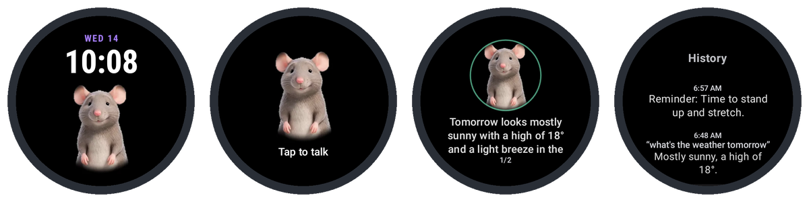

# Lux Watch

A Wear OS app that turns a Samsung Galaxy Watch into a Muse voice gadget: tap
Lux, talk, and your Muse answers on your wrist.



> **Unofficial.** Lux Watch is an independent project, not made, endorsed or
> supported by Meta. It builds on Meta's open-source
> [Muse Gadget SDK](https://github.com/facebookincubator/muse-gadget-sdk).
>
> **Beta.** Talking to Muse, pairing and the watch face run on a Galaxy Watch4
> Classic. Messages from Muse, avatar import, the face's complications and the
> hardware video playback are newer and have had little testing on a watch.

## Quick start

You need a Galaxy Watch (Wear OS 3 or later), an Android phone with the Muse
app, a computer with `adb`, and an SDK token from
[gadgets.muse.ai](https://gadgets.muse.ai/settings/sdk-tokens).

1. Download **[lux-watch.apk](https://github.com/arvindavidson/lux-watch/releases/latest/download/lux-watch.apk)**
   from the [latest release](https://github.com/arvindavidson/lux-watch/releases/latest).
2. Connect the watch to your computer with adb (Developer options → ADB
   debugging and Wireless debugging; [BUILD.md §3](BUILD.md#3-enable-sideloading-on-the-watch)),
   then run `adb install -r lux-watch.apk`.
3. Open **Lux Watch** on the watch. In the Muse app, add a gadget: the watch
   shows up, and the Muse app pairs with it over Bluetooth.
4. On the watch, swipe to **Settings → SDK token**: it shows a QR code. Scan
   it with your phone, paste your token on the page that opens and tap
   **Send** (Chrome on Android); the watch asks you to confirm. Or tap **Type
   it instead** (a Galaxy watch lets you paste with the phone's keyboard).
5. Tap Lux and talk. For the watch face: long-press your current face, swipe
   to the end, tap **+** and pick **Lux**.

[BUILD.md](BUILD.md) has the details, building from source and troubleshooting.

## How it works

1. **Pair**: the watch advertises over BLE; the Muse phone app pairs using
   protocol v5 (P-256 ECDH) and provisions device tokens.
2. **Connect**: the watch fetches its VM list, opens a Noise-secured WebSocket
   (`Noise_XX_25519_AESGCM_SHA256`) and registers over `/link-control`. One
   connection serves the whole app. It connects when you open Lux (or raise
   your wrist, if you used Lux in the last half hour) and closes after a couple
   of idle minutes; with Settings → Messages from Muse on, it stays up and
   reconnects on its own.
3. **Talk**: tap Lux (on the watch face, the tile or the complication), speak,
   and stop: it sends when you stop talking. The 16 kHz recording goes to
   `/chat/stream` as a voice note (as Meta's ESP32 boards send it); the reply
   streams back over `/chat/subscribe` and is shown and spoken with on-device
   TTS (Muse sends no reply audio). From the face, Lux returns to the face after.
4. **Muse can reach the watch**: it offers Muse commands in `link.register`
   (`watch.notify` for reminders and messages, `device.health`,
   `avatar.set_clips`) and answers `link.invoke`.
5. **Avatar**: Lux plays Muse's own avatar clips (background turned black);
   anyone's Muse can send its clips to the watch (Settings → Get my avatar).
   Pixel-art avatars are built in too. See `docs/muse-avatar.md`.
6. **Watch face**: the time, two complications and the avatar. To save
   battery the avatar is a still frame unless Lux is listening, thinking or
   speaking, or a reply or message has just arrived; on the talk screen Lux's
   clips play through the watch's hardware video decoder.

## Layout

- `docs/PROTOCOL.md` — exact protocol spec extracted from Meta's
  `muse-gadget-sdk` Python Linux SDK (every claim cited).
- `gadget/` — pure-Kotlin protocol client (no Android dependencies):
  protobuf codec, Noise XX, chunk/service framing, HTTPS API, WebSocket
  transport, session logic, link commands, end-of-speech detection, pixel
  avatars and the clip background keyer. Tests: `./gradlew :gadget:test`;
  vectors and their generator live in `gadget/src/test/resources/` and
  `gadget/tools/`.
- `app/` — Wear OS app: talk, history and settings pages, watch face, tile,
  complication, BLE pairing server, encrypted storage, the shared connection,
  Muse's commands, avatar clips and import, TTS. Screenshot tests:
  `./gradlew :app:testDebugUnitTest` (images in `app/build/screens/`).
- `docs/token/` — the "Send token to watch" page (GitHub Pages), which sends
  the SDK token to the watch over Web Bluetooth.
- `BUILD.md` — build, sideload, and pairing instructions.
- `docs/muse-avatar.md` — putting your Muse's own avatar on the watch.

## Verified

Runs on a Galaxy Watch4 Classic (One UI 8 Watch / Wear OS 6): pairs with the
Muse app over BLE and talks to Muse. The Noise handshake, framing and BLE
pairing key schedule are checked byte-for-byte against Meta's
`muse-gadget-sdk` (see `gadget/src/test/resources/README.md`):

```
PASS ble.community_v5 / official_v5 / community_app_v5 (ecdh, transcript, keys, session id, client_finished record)
PASS noise.msg1 (32 bytes) / readMessage2 / msg3 (64 bytes) / transport_ct (32 bytes)
PASS proto.varint(1) / varint(300) / int64field(1,-1)
PASS framing.service_frame (78 bytes) / framing.chunk[0] (92 bytes)
```

## Features

- Talk screen: tap to talk, sends when you stop speaking; replies shown and read
  aloud; the bezel sets the volume (with a ring and a haptic tick) and pages
  through long replies; haptics.
- History page: recent exchanges and Muse's messages, kept on the watch.
- Settings: Muse connection, SDK token (typed or pasted on the watch), Messages
  from Muse, voice and speed, volume, haptics, avatar, re-pair.
- Lux watch face with complications and a Customize screen; tile; complication.

## Open risks

- The Lux watch face uses the AndroidX watch face library. Google stopped
  allowing installs of such faces in January 2026 (Watch Face Format is
  required); sideloading still works on the Watch4 Classic today.
- Messages from Muse need the link up: the process stays alive while Lux is the
  watch face; with another face, Android may stop it in the background.
- Whether Muse can give HTTPS links to its avatar clips for `avatar.set_clips`
  is untested.
- `noise_host` vs `vm_ws_url` domain: the pairing record is authoritative.

## License

Apache License 2.0: see [LICENSE](LICENSE) and [NOTICE](NOTICE).
